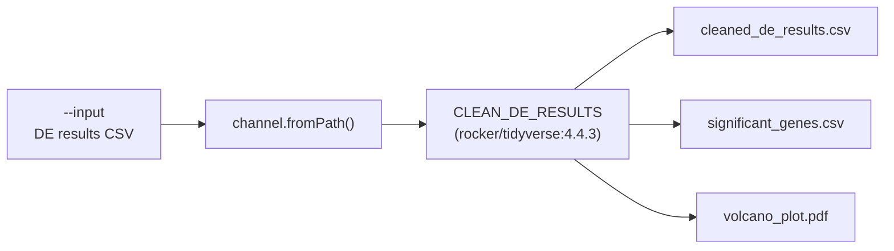

# Transcriptomic Data Processing PoC

A minimal, containerised Nextflow pipeline that cleans and classifies RNA-seq differential expression results and generates a volcano plot.

---

## Rationale

Analysis logic in research settings often lives in standalone R or Python scripts. These scripts work, but they are hard to rerun identically. They depend on the analyst's local package versions, hard-coded paths and manual execution order.

This repository is a proof of concept for moving such a script into a **scalable, containerised Nextflow pipeline** without rewriting the science. The original R analysis is kept as-is in `bin/`, and Nextflow and Docker provide:

- **Reproducibility:** every run uses the same pinned software environment, regardless of the host machine.
- **Portability:** the same command runs on a laptop, an HPC cluster or the cloud by changing configuration, not code.
- **Traceability:** each run produces execution reports recording what ran, when, with which parameters, and the resources used.
- **Separation of concerns:** analysis logic (`bin/`), workflow logic (`main.nf`) and run configuration (`nextflow.config`) are kept apart.

The pipeline is deliberately kept to a single process so the core patterns stay easy to review. The same structure extends naturally to multi-step workflows.

---

## Requirements

| Software | Version | Notes |
|---|---|---|
| [Nextflow](https://www.nextflow.io/docs/latest/install.html) | ≥ 24.04.0 | Requires Java 17 or later |
| [Docker](https://docs.docker.com/get-docker/) | Any recent version | The Docker daemon must be running |

No local installation of R or of any R packages is required. All analysis dependencies are provided by the container.

---

## Quick Start

**1. Clone the repository**

```bash
git clone https://github.com/<tgoedkoop>/<rnaseq-clean-poc>.git
cd <rnaseq-clean-poc>
```

**2. Make the analysis script executable** (only needed once, after cloning)

```bash
chmod +x bin/clean_rna_seq.R
```

**3. Run the pipeline on the included test data**

```bash
nextflow run main.nf --input data/de_results.csv
```

The first run pulls the Docker image (about 2 GB), which may take a few minutes. Later runs start immediately.

**4. Run with custom thresholds**

```bash
nextflow run main.nf --input data/de_results.csv --padj 0.01 --lfc 1.5
```

**5. Resume after a change or interruption** (reuses cached results for unchanged steps)

```bash
nextflow run main.nf --input data/de_results.csv -resume
```

### Parameters

| Parameter | Default | Description |
|---|---|---|
| `--input` | *(required)* | Path to a CSV of differential expression results |
| `--outdir` | `results` | Directory where outputs are published |
| `--padj` | `0.05` | Adjusted p-value cutoff for significance |
| `--lfc` | `1` | Absolute log2 fold-change cutoff for significance |

### Input format

A CSV containing at least the following columns, as produced by DESeq2's `results()`:

| Column | Description |
|---|---|
| `log2FoldChange` | Estimated log2 fold change |
| `padj` | Multiple-testing adjusted p-value |

Additional columns (e.g. gene ID, `baseMean`, `pvalue`) are kept in the output.

The included `data/de_results.csv` is a **simulated** dataset of 2,000 genes. It contains no patient or proprietary data.

### Outputs

```
results/
├── cleaned_de_results.csv      # All genes with complete statistics + Significance column
├── significant_genes.csv       # Upregulated and downregulated genes only
├── volcano_plot.pdf            # log2FC vs -log10(padj), thresholds marked
└── pipeline_info/
    ├── report.html             # Execution report (resources, runtime, parameters)
    ├── timeline.html           # Task timeline
    └── trace.tsv               # Per-task execution trace
```

---

## Pipeline Architecture



### Repository structure

```
.
├── main.nf                 # Workflow logic: channels, process, data flow
├── nextflow.config         # Run configuration: parameters, Docker, reports
├── bin/
│   └── clean_rna_seq.R     # Original analysis logic (standalone R script)
└── data/
    └── de_results.csv      # Simulated test dataset
```

### How it works

1. **Input:** `channel.fromPath()` creates a channel from the `--input` file and fails fast if the file does not exist.
2. **Processing:** the `CLEAN_DE_RESULTS` process runs `bin/clean_rna_seq.R` inside the `rocker/tidyverse:4.4.3` container. The script:
   - removes genes with missing `padj` or `log2FoldChange` (e.g. those removed by DESeq2's independent filtering);
   - classifies each gene as *Upregulated*, *Downregulated* or *Not Significant* using the supplied thresholds;
   - draws a volcano plot whose threshold lines match the classification exactly.
3. **Isolation:** each task runs in its own directory under `work/`. This is what enables caching and `-resume`.
4. **Publishing:** `publishDir` copies the declared outputs from `work/` into `results/`.

### Reproducibility controls

| Control | Implementation |
|---|---|
| Fixed software environment | Docker image pinned to an exact version tag (`rocker/tidyverse:4.4.3`), never `latest` |
| Fixed package versions | Rocker images for past R releases install CRAN packages from a frozen snapshot date |
| No hard-coded paths or thresholds | All inputs and cutoffs are set through `params` and the command line |
| Engine version guard | `manifest.nextflowVersion` refuses to run on unsupported Nextflow versions |
| Run provenance | Execution report, timeline and trace written for every run |
| Input validation | Missing files, missing columns and non-numeric thresholds produce clear errors |

---

## Limitations and Next Steps

This is a deliberately minimal proof of concept. Natural extensions include:

- **Multi-sample support:** prefix outputs with the input file name so that several comparisons can be processed in parallel from a glob (`--input 'data/*.csv'`).
- **Continuous integration:** a GitHub Actions workflow that runs the pipeline on the test data on every push.
- **Digest pinning:** reference the container by its `sha256` digest for byte-level immutability.
- **Upstream steps:** extend the pipeline backward from DE results to read QC, alignment or quantification, and DESeq2 itself.
- **Execution profiles:** add `-profile` options for HPC schedulers (e.g. SLURM with Singularity/Apptainer) or cloud executors.
- **Community standards:** adopt nf-core conventions (modules, parameter schema validation) as the pipeline grows.

---

## Author

**Tabitha Goedkoop**
